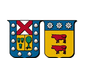

---
hide:
  - navigation
---

<h1>Machine Learning — EGEI</h1>

Learn the foundations of machine learning while working the way data teams actually work today:
side by side with an AI coding assistant. You will not just prompt it — you will read, test and
defend every line it writes.

SessionsFridays 13:00–16:00

Term11 Sep – 27 Nov 2026

Checkpoint 1 · 40%Due Thu 12 Nov

Final delivery · 60%Due Thu 26 Nov

One case runs through the whole course: [**predicting household poverty with CASEN**](case.md).
Every session, with its notebook, is in [**Classes**](classes/classes.md); deadlines and rubric are
in [**Project**](projects.md); the formal syllabus is in [**Program**](program.md).

## What this course is about

Machine learning has two halves. One is **statistical**: what a model is, what it can and cannot
learn from data, and how to tell a real signal from noise. The other is **craft**: turning a
business question into data, code and a decision someone can act on.

This year the craft half changes. Writing code is no longer the bottleneck — **reviewing it is**.
So every session pairs a modelling topic with the corresponding assistant skill: how to ask for the
right thing, how to check the answer, and how to recognise when the assistant is confidently wrong.

### Modelling foundations
Regression, classification, resampling, trees, regularization and clustering, all on one real
policy problem, with emphasis on *why* a model works, not only on calling `.fit()`.

### Assistant-driven workflow
Use Copilot, Claude, ChatGPT or Cursor as a pair programmer: scaffolding, refactoring, debugging
and explaining code — under a verification discipline you can defend.

### One real project
Everything is assessed through one end-to-end project on real data, in two deliveries, with code,
a written report and a live presentation.

## Learning outcomes

By the end of the course you will be able to:

1. Frame a business question as a supervised learning problem, and say what a good answer looks like.
2. Prepare, explore and visualize a real dataset in Python, reproducibly.
3. Choose, fit and tune regression and classification models, and justify the choice.
4. Evaluate models honestly: train/test discipline, cross-validation, uncertainty and the right metric.
5. Work with an AI coding assistant productively — and verify its output rather than trusting it.
6. Communicate results and limitations to a non-technical audience.

## What you need

| You need | Details |
|---|---|
| **Python environment** | Local install (Anaconda/`uv`/`venv`) or Google Colab — both work |
| **Code assistant** | At least one of: GitHub Copilot, Claude, ChatGPT, Gemini, Cursor (free tiers are enough) |
| **Background** | Basic programming and basic statistics; no prior ML required |

See the [Code Assistants](code-assistants.md) page for setup, prompting patterns, the
verification checklist and the course policy on assistant use.

## Instructor

### Sebastián Azócar
Data Scientist @ LATAM Airlines Group · Lecturer

Mathematical Engineer (USACH) with an MSc in Data Science (Universidad del Desarrollo). Over five
years applying machine learning in industry — Caja Los Andes, Walmart Chile and currently LATAM
Airlines Group — and more than a decade teaching data science and statistics.

[LinkedIn](https://www.linkedin.com/in/sebasti%C3%A1n-az%C3%B3car/)

Material and student projects from previous editions are in the [Archive](archive.md).
